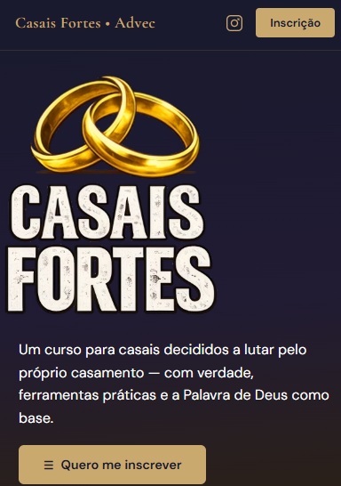
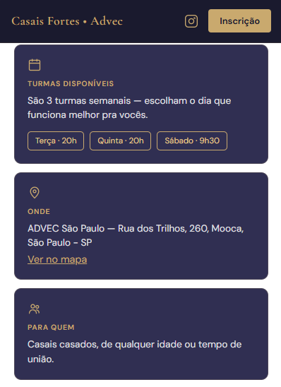
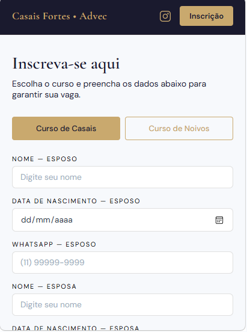

# Casais Fortes

Uma plataforma Web para o Ministério Famílias Vitoriosas da ADVEC São Paulo.
O site apresenta o curso e permite que casais e noivos se inscrevam online, com os dados salvos automaticamente em uma planilha.

🔗 **[Acessar plataforma](https://curso-casais-fortes.vercel.app/)**

## Sobre o Projeto
A igreja realiza o curso Casais Fortes em três turmas semanais, além de uma turma específica para noivos. As inscrições precisavam de um canal simples, acessível pelo celular e fácil de organizar para quem coordena.

O projeto resolve isso com uma página leve, pensada primeiro para o celular, que apresenta o curso, tira as dúvidas principais e leva o casal direto para a inscrição. Cada formulário enviado vira uma linha na planilha da equipe, sem sistema complicado e sem custo de servidor.




## Funcionalidades
- **Mobile-first:** layout pensado primeiro para o celular.

- **Dois formulários em um:** alterna entre Curso de Casais e Curso de Noivos sem recarregar a página.

- **Integração com Google Sheets:** as inscrições chegam em tempo real na planilha via Google Apps Script.

- **Tela de confirmação:** após o envio, o casal vê uma mensagem de sucesso com botão direto para o WhatsApp.

- **Carrossel de depoimentos:** scroll horizontal com indicadores de página

- **Animações de entrada:** os cards aparecem conforme a rolagem, usando IntersectionObserver


<table>
  <tr>
    <td align="center"><b>Sobre o curso</b></td>
    <td align="center"><b>Formulário de Inscrição</b></td>
  </tr>
  <tr>
    <td></td>
    <td></td>
  </tr>
</table>

## Tecnologias utilizadas 
- HTML5 — estrutura da aplicação.

- CSS3 — estilização, layout e responsividade.

- JavaScript — funcionalidades, validações e interatividade.

- Google Sheets — armazenamento das inscrições.

- Vercel — hospedagem e publicação.

## Como executar o projeto

1. Clone este repositório:

   ```bash
   git clone https://github.com/GabiDanielly/Curso-Casais-Fortes.git
   ```

2. Abra a pasta do projeto no VS Code.

3. Execute o arquivo `index.html` utilizando a extensão Live Server ou abra-o diretamente no navegador.


## 🌐 Acesse a plataforma 
https://curso-casais-fortes.vercel.app/ 


## Autor 
**Gabriela Danielly**

 [Linkedin](https://www.linkedin.com/in/gabrieladanielly/) |  [GitHub](https://github.com/GabiDanielly)   
